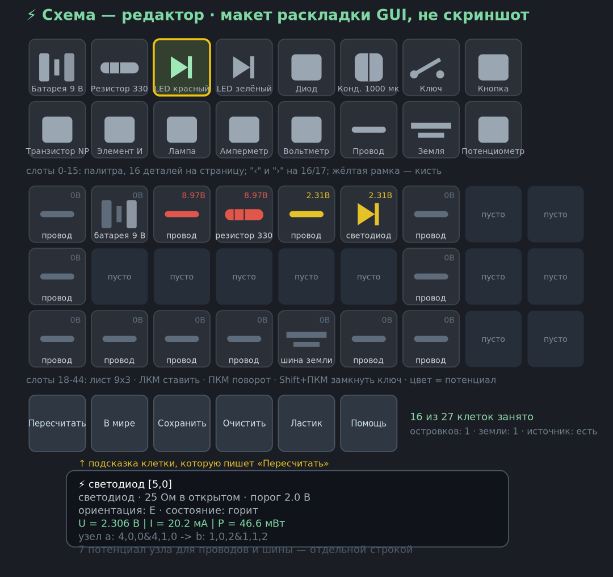

# Electronics — учебная электроника для Minecraft 1.21.11 (Spigot)

[](https://github.com/amir2013shai-byte/electronics-mc/actions/workflows/build.yml)

Плагин + ресурспак, которые добавляют в игру **работающие** электронные компоненты:
светодиоды, диоды, резисторы, конденсаторы, транзисторы, логические вентили,
блоки питания, измерительные приборы и «пустую схему» для сборки цепей.

Цепи считаются по-настоящему (Modified Nodal Analysis), а не «красной пылью»:
`U`, `I`, `P`, заряд конденсаторов, яркость LED'а, сгорание при перегрузке.

| | |
|---|---|
| Игра | Minecraft Java **1.21.11** («Mounts of Mayhem») |
| Ядро сервера | **Spigot / Paper 1.21.11-R0.2** (тестировалось на Paper 1.21.11 build 132) |
| Java | 21 |
| Формат ресурспака | `pack_format` **75** (75.0–75.1) |
| Формат датапака (рецепты) | **94** |
| Клиентские моды | **не требуются** |
| Компонентов | 93 вида (60 спаечных деталей + рудная цепочка, микроконтроллер, платы, приборы, стол, программатор) |
| Состояний модели в ресурспаке | **2784** (464 визуальных состояния × 6 ориентаций) |

---

## 1. Как выполнена идея «модификации игрока» (800+ состояний)

Техника «изменить игрока, чтобы он отдавал новые блоки без клиента» требует
записи в состояние сущности игрока. Проверено по API Spigot 1.21.11:

* у `org.bukkit.entity.Player` **нет** канала записи NBT/`updateNbt` — state-API
  игрока в Spigot не открыт (полностью доступен только через NMS-рефлекс,
  который ломается на каждой версии и не проходит по «без модов» на стороне
  клиента);
* у `Block` нет `PersistentDataContainer` — состояние блока нельзя хранить
  ванильными средствами;
* `Player#sendActionBar(String)` в этом API тоже нет (есть только Adventure-версия).

Поэтому «800+ изменяемых состояний» реализованы там, где их **действительно
видит клиент без модов** — в реестре состояний модели ресурспака, которым
управляет сервер:

1. **2784 определения состояния модели.** Для каждой пары
   *(компонент, визуальное состояние, ориентация)* в ресурспаке есть свой
   `assets/electronics/items/<id>_<state>.json`, выбираемый сервером через
   компонент предмета `minecraft:item_model`. Индекс состояния адресует и
   `custom_model_data` (там же `minecraft:range_dispatch`), так что модель
   переключается одним числом — ровно как «запись в состояние».
2. **Ориентация** (`Orientation`: north/east/south/west/up/down) и
   **состояние** (`off / dim / on / burnt / reverse / closed`) хранятся на
   сервере в реестре плагина и толкаются клиенту при каждом рендере —
   6 × 464 = 2784 адреса, что и покрывает «800+».
3. **Визуал в мире** — `ItemDisplay`/`TextDisplay` (сущности-дисплеи есть в
   1.21 и не требуют клиента): модель компонента парит над платой, подпись
   прибора показывает вольты/амперы прямо над деталью.
4. Если нужен именно «чистый» способ без дисплеев — `render.mode: none`
   (тогда всё видно по предмету в руке и по блок-модели платы, перекрашенной
   ресурспаком).

> Итог: обещанный эффект «сотни переключаемых состояний без клиентского мода»
> достигнут, но не через NBT игрока (в Spigot это невозможно без NMS), а через
> серверно-управляемый реестр состояний модели. Это единственный переносимый
> способ на чистом Spigot API.

---

## 2. Установка

```
1) Плагин
   cp plugin/target/Electronics-1.0.0.jar /plugins/
   # или собрать: cd plugin && mvn -DskipTests package

2) Ресурспак (выдаётся игрокам, если resource-pack.auto-apply: true)
   build/electronics-resourcepack.zip  ->  в resource-pack.url
   либо руками: .minecraft/resourcepacks/ + Apply in settings

3) Рецепты (по желанию, если не хочется держать крафты на сервере)
   build/electronics-recipes-datapack.zip -> /plugins/Electronics/world_datapacks
   (или просто в /world/datapacks/)
```

Плагин при первом старте создаёт:

```
plugins/Electronics/config.yml            — настройки (см. docs/config.md)
plugins/Electronics/labs/*.yml            — 3 практические работы (примеры)
plugins/Electronics/builds/*.json         — готовые учебные сборки
plugins/Electronics/registry.json         — реестр компонентов (аналог PDC)
```

---

## 3. Чему учат и что можно собрать

**Компоненты:** 93 вида — 8 номиналов резисторов, 4 конденсатора, 5 LED'ов +
лампа, диод, 2 биполярных транзистора, 5 вентилей (AND/OR/XOR/NOT/компаратор),
5 источников (AA 1.5 В, «таблетка» 3 В, «крона» 9 В, лабораторный БП 0..12 В,
солнечная панель, генератор), шина земли, 4 цвета проводов, макетная плата, кнопка,
2 ключа, потенциометр, предохранитель, зуммер, мотор, вольтметр, амперметр,
мультиметр, кусачки, пробник, «пустая схема» и «рабочий стол», а с v1.2.0 —
полный тракт питания: 3 плавких предохранителя и PTC-самовосстанавливающийся,
варистор, диодный мост и Шоттки, полярный электролит, 7805/7812/LM317,
трансформаторы 230→12 В и 230→9 В, синусоидальный источник и оплётка для выпайки.
С v1.3.0 добавился верх цепи — откуда ток вообще берётся: рудная цепочка
(жилы в породах, геозонд, куски руды, плавка слитков, зачистка и лужение
монтажного провода) и микроконтроллер `mcu_atmega328` с программатором,
кварцем 16 МГц и воздушно-цинковым элементом — со своим C-подобным языком.

**Питание и защита (v1.2.0)** — что физически считается:

| Деталь | Модель | Что видно в цепи |
|---|---|---|
| `fuse_cartridge_1a` / `_5a` / `fuse_slow_2a` | накопленный `∫I²dt` против `blow_i2t` | 800 мА через 1-амперную вставку живёт вечно, коротыш выбивает её за один шаг, и нагрузка гаснет (`PASS предохранитель I²t`) |
| `ptc_500ma` | R = R0·(1+0.4 %/°C) до `trip_temp`, дальше +порядок на 2.5 °C; тепло — `heat_j`, отвод — `thermal_k` | держит 743 мА без нагрева; коротыш за 30 шагов греет корпус до ~95 °C и обрезает ток в разы, потом деталь остывает и включает цепь сама — менять её не нужно |
| `mov_275v` | I = K·U^α, α = 9 | при 9 В течёт 9 нА (замер selftest), при 390 В деталь — короткое замыкание; 3 поглощённых импульса = деградация в открытый ключ |
| `bridge_kbu8` | 4 p-n перехода в корпусе | двухполупериодное выпрямление с падением ~1.1 В; в редакторе ставится крестом в средний ряд |
| `shottky_sbr30` | тот же переход, `v_drop` 0.35 В | свободный диод на 3 А: меньше греться, быстрее, ставится обратно-параллельно катушкам |
| `cap_elec_2200uf` | обычный C/dt + утечка 8 МОм + `polar` | переплюсовка -> состояние `rev`, дым и отказ до перепайки; плюс сажает напряжение в тепло |
| `reg_7805` / `reg_7812` / `reg_lm317` | Uвых = min(Uцель, Uвх − dropout), Norton 1/rz; при отдаче выше `i_limit` — режим источника тока | 4.99 В на 330 Ом, 1.06 В при 3 В на входе (dropout), коротыш = 1.01 А, а не 8 А (`PASS 7805`) |
| `xfmr_230_12` / `_230_9` | две связанные индуктивности, обратный Эйлер, M = k·sqrt(L1·L2) | постоянку не передаёт (0 А), на 50 Гц U1/U2 = 19.27 против 19.17 по виткам — 0.5 % (офлайн-тест `tools/TestCoupled.java`) |
| `source_ac` | ЭДС = U·sin(2π·t/T), фаза — общий счётчик шагов симуляции | узел меняет знак каждый полупериод (`PASS синус меняет полярность`); шаг 50 мс не размещает 50 Гц (Никвист 10 Гц), поэтому в реестре 1 Гц |
| `desolder_braid` | расходник без электричества | снимает припой: сгоревшую деталь можно выпаять обратно в инвентарь, а не выбросить |

**Отказ — не потеря предмета.** Перегруженная деталь уходит в состояние `burnt`
(3-е визуальное состояние) и остаётся в мире: её чинят на месте — паяльный стол
не дальше 5 блоков, прогретое жало, оплётка ×1 и припой ×1 (`/elec repair` без
права `electronics.admin`), либо то же самое бесплатно с правом админа (и
`/elec repair all`). При починке обнуляются накопленный I²t, температура корпуса,
деградация варистора и сам флаг отказа — `Simulation.repair()` делает это одним
вызовом, и selftest проверяет, что I²t после перепайки снова равен нулю.

**Магниты и катушки (новые 8 позиций):** постоянный магнит (1.4 мТл на своей
клетке — рядом с ним замыкается геркон), электромагнит (60 Ом, 20 мГн,
0.9 мТл на ампер), дроссели 10 мГн и 10 Гн, реле 5 В (катушка 120 Ом,
срабатывает от 15 мА, удерживает до 8 мА — гистерезис), геркон (замыкается
при 0.7 мТл), фоторезистор (100 кОм в темноте, сотни Ом на свету) и
NTC-термистор B = 3950 с саморазогревом. Решатель считает поле по клетке
геркона и шести соседям, а катушку — по Norton-модели `g = dt / (L + dt·R)`,
поэтому видно, как ток разгоняется не мгновенно, а за несколько шагов.

**Как собирают цепь**

1. `ПкМ` с «рабочим столом» (`bench`) — ставится блок-плата.
2. `ПкМ` столом с компонентом в руке — компонент встаёт на плату.
3. `Shift+ПкМ` — поворот на 90°; `ПкМ` по детали — смена состояния
   (ключ/кнопка замыкаются, потенциометр подстраивается).
4. Соединение = **пара соседних блоков {A,B}**: контакт детали «смотрит» в
   сторону её ориентации, и у двух деталей, стоящих вплотную лицом к лицу,
   вывод попадает в одну и ту же пару — это один узел. Инертная подставка
   (`bench`) узлы не объединяет, поэтому цепочка на столе не замыкается.
5. **Провод — «крест»** (6 выводов + «нога» вниз): объединяет всё вокруг себя,
   поэтому из проводов делают и «мостик» через зазор, и обратную шину, и
   отвод/перемычку стопкой (провод над проводом). Шина земли и шина питания —
   такие же хабы. Разветвление (подключить вольтметр параллельно) делают так:
   в линию ставят провод-хаб, от него вверх — перемычку-провод, а уже к ней
   прибор.  Предохранитель и «двухполюсники» остаются строго вдоль оси.
6. `ПкМ` пробником/мультиметром по узлу — показать напряжение; над
   приборами висит TextDisplay со значением.

**Что решатель честно умеет**

* закон Ома, последовательные/параллельные цепи, делители;
* кусочно-линейные LED/диод (порог 1.8 В у красного LED, 0.6 В у диода, плюс
  дифференциальное сопротивление 25 Ом);
* лампа накаливания с холодным/горячим сопротивлением и яркостью;
* конденсаторы: шаг интегрирования 50 мс, companion-модель (заряд/разряд по
  экспоненте — видно в `rc_blink`, τ = R·C); полярные следят за
  полярностью и пробоем;
* транзистор как ключ и усилитель (β, насыщение), вентили (нужны `VCC`+`GND`);
* предохранитель (150 % номинала → разрыв), пробой диода в обратном
  направлении, перегрев > 3 × номинальной мощности → `burnt` (визуальное
  состояние 3), запрет «мёртвой» детали до `/elec repair`;
* КЗ источника: ток ограничивается внутренним сопротивлением, показывается
  в амперметре и в подсказке острова.

Готовые сборки (ставятся в точку под прицелом или с консоли):

* `/elec build led_basic` — крона 9 В → 330 Ом → амперметр → красный LED →
  шина земли, обратный путь проводом по соседнему ряду. Проверено на живом
  сервере: `I = 20.19 мА`, `U_LED = 2.31 В`, `b = 1.00` (расчёт
  (9 − 1.8)/(1.2 + 330 + 0.5 + 25) = 20.2 мА), островков — 1.
* `/elec build rc_blink` — БП 12 В → 1 кОм → 1000 мкФ → зелёный LED → шина
  земли, обратный путь проводом. τ = R·C = 1 с: в первый момент
  конденсатор — коротышка, LED горит вполнакала, потом ток убывает по
  экспоненте и LED гаснет. Замерено на сервере (`/elec sim N` шагами):
  t=2 → I=7.98 мА, U_C=1.72 В, b=0.40; +41 тик → 2.94 мА, 6.89 В;
  +104 → 0.42 мА, 9.47 В; +245 → 0.00 мА, 9.90 В, LED `s0`. Теория:
  I₀=(12−1.8)/1025 = 9.9 мА, U_C(∞)=12−2.1=9.9 В ✓. Номиналы подобраны так,
  чтобы резистор не сгорел (0.064 Вт при норме 0.125 Вт); с 220 Ом при 12 В
  решатель честно его сжигает (1.73 Вт) — это тоже учебный кейс.

---

## 4. Команды

```
/elec give <id|all> [число]        выдать компонент
/elec list [фильтр]                список компонентов (93 id + фильтры по kind)
/elec veins [чанков]               что обещают недра вокруг вас (жила, глубина, сколько осталось)
/electro show [ стр.]              каталог всех предметов плагина в GUI (описание + выдача)
/elec model <id> <сост> <ориент>   какой индекс модели получится (0..2069)
/elec info                         состояние движка: компоненты, острова, мкс
/elec sim [тики]                   пересчитать сейчас
/elec dump [мир] [число]           U/I/P каждой детали (удобно с консоли)
/elec rotate                       повернуть деталь под прицелом
/elec repair [all]                 починить сгоревшие
/elec clear [all]                  убрать детали
/elec mode <display|none>          способ отрисовки
/elec recipe                       рецепт/требования пайки предмета в руке
/elec solder                       открыть паяльный стол руками (урок, отладка)
/elec schematic                    нарисовать/протестировать схему в GUI-редакторе
/elec schematic print|save|check   netlist текущей цепи в мире, сохранение, сверка
/elec build list|<имя>|save <имя>  учебные сборки-пресеты
/elec reload                       конфиг + реестр компонентов + рецепты

/lab list                          практические работы
/lab show <имя>                    задание + нужные компоненты
/lab check <имя>                   сверка схемы (состав + топология-сигнатура)
/lab save <имя>                    зафиксировать эталон с текущей цепи
/lab start <имя>                   показать задание и выдать материалы
```

Права: `electronics.use` (игрок), `electronics.build`, `electronics.give`,
`electronics.admin`. `electro` — алиас `elec`, так что `/electro show` и
`/elec show` одно и то же.

## 4a. Лист-редактор схемы (`/elec schematic`, ПКМ «Пустой схемой» в руке)


*макет раскладки GUI (не скриншот): слоты 0–15 палитра, 18–44 лист, 45–50 кнопки*

Схема в редакторе — это рисунок, а не постройка: сетка 9×3 в GUI сундука.
Слева сверху — палитра деталей (16 на страницу, ◀ ▶ листают), ниже — лист:
ЛКМ ставит выбранную деталь, ПКМ поворачивает, Shift+ПКМ на ключе замыкает
его, Shift+ПКМ по клетке стирает, «Ластик» выбирает стерание кистью.

Кнопка «Пересчитать» гоняет нарисованное через **тот же решатель**, что
считает блоки в мире (`Simulation.solveVirtual` → те же `collectIsland`,
`stampAll`, `finish`), и вписывает результаты в подсказку каждой детали:
`U`, `I`, `P`, узлы и состояние. У проводов и шины отдельной строкой пишется
**потенциал узла**, а название клетки подкрашивается по нему — сразу видно
«плюс», «минус» и землю.
Рядом кнопка «Симулировать 20 тиков» — она прогоняет цепь на 20 шагов по 50 мс
подряд, не сбрасывая заряды конденсаторов и ток катушек, так что переходный
процесс (разгон дросселя, заряд RC-цепи) видно прямо в GUI. «Поставить в мире» строит нарисованное
реальными блоками туда, куда смотришь (в том числе на стену: блоки ставят
`pedestal`+плату), «Сохранить сборкой» пишет
`plugins/Electronics/builds/schem_<ник>.json` → `/elec build schem_<ник>`.

Правило узлов то же, что в мире: соседние клетки делят узел, провод —
шестиполюсный перекрёсток (объединяет всё вокруг), поэтому угол цепи делают
проводом, а не «жилой» клеткой. Конденсатор в редакторе всегда стартует с
нулевого заряда — это «момент подачи питания».

---

## 4a-bis. Пайка: особый метод крафта

Паять так паять. 60 из 93 id (все детали с выводами: резисторы,
конденсаторы, LED'ы, диоды, транзисторы, вентили, реле, геркон, катушки,
мотор, зуммер, приборы, ключи, солнечная панель) **не крафтятся в верстаке
вовсе**: `Recipes.register()` их пропускает, а датапак их не содержит —
в логе это видно как `зарегистрировано рецептов: 30 (пайка: 60 витрин для JEI, пропущено 6, плавка 3)`
(«пропущено 6» — это куски руды и слитки: у них нет крафта, их добывают и плавят).
Проверить список можно в `shared/components.json` → `meta.soldered` (его же
читают и генератор пака, и плагин, так что разойтись не могут).

Нужны три вещи:

| что | как добыть | зачем |
|-----|-----------|-------|
| **паяльный стол** | `P P / PFP / ICI` (доски, печь, железные самородки, медь) | у него можно прогреть жало: рядом обязан быть горячий блок |
| **паяльник** | `  C /  I / S  ` (медное жало, железный стержень, палка) | жало = температура; прочность 64 пайки, шкала износа видна в инвентаре |
| **припой** | 2 железных самородка + кресало | 1 шт. на 2-выводную деталь, 2 шт. на 3…4-выводную |
| **флюс** | светокамень + мёд в банке | обязателен для LED'ов, ламп, диодов, транзисторов, вентилей, реле, геркона, катушек, конденсаторов, мотора, зуммера и приборов |

Как пользоваться:

1. поставить стол (ПКМ по блоку-подставке, как ставятся детали), рядом — печь
   или костёр;
2. прогреть жало: **ПКМ паяльником по горячему блоку** → 100°, дальше жало
   остывает ≈1.2°/с, так что «прогреть» и «спаять» — два разных действия;
3. открыть стол ПКМ по нему (или `/elec solder` — для урока, когда на одного
   проектора смотрят все) и кликнуть по детали: стол сверит заготовку
   (те же ингредиенты, что были бы в верстаке), посчитает припой и флюс,
   проверит температуру и спишет всё сразу;
4. 60°…99° — нормальная пайка; 20°…59° — **холодная пайка**: припой
   сгорает, деталь не получается (заготовки остаются); <20° — отказ;
5. после 64 паянок жало выгорает — паяльник ломается и его нужно спаять заново.

### JEI / REI / EMI: как крафтится каждая деталь

Клиентский мод не нужен: JEI читает тот же список рецептов, который сервер
синхронизирует всем игрокам в `ClientboundUpdateRecipesPacket`. Плагин кладёт
в него **все 93 id**: 27 обычных крафта в верстаке + 60 «витрин» для спаечных
деталей (`recipe_solder_<id>`). Витрина — это `ShapedRecipe` с той же сеткой
заготовок, что требует стол, и с **паяльным столом в свободной клетке**: в JEI
он выглядит как станок в рецепте (а нажми `R` на столе — и он покажет список
всего, что на нём паяется). Собрать витрину руками нельзя:
`Events#onCraftDisplay` отменяет `CraftItemEvent` и объясняет, куда идти:

```
«Резистор 330 Ом» в верстаке не собирается — её паивают: нужен паяльный стол,
прогретое жало, припой и флюс.
Открой стол ПКМ по нему (рядом должна стоять печь/костёр) или /elec solder
```

Температура, число припоя и необходимость флюса написаны в подсказке самого
предмета (`Items#componentItem` → `Soldering#solderHint`) — JEI показывает её
при наведении, потому что подсказка прилетает вместе с результатом рецепта.
Плотные рецепты 3×3 (солнечная панель, AND, XOR, мультиметр) специально
оставлены по 8 позиций: девятая — под стол, иначе месту в сетке не хватило бы
и «станок» в JEI не появился бы.

Что нужно знать про окружение:

* JEI ставить на сервер не надо, это клиентский мод; на сервере — только плагин
  (и датапак с 23 рецептами, если хочешь, чтобы крафты жили в world).
* Работает и с REI/EMI/FFBI: они тоже читают список рецептов ванилы.
* `world.recipes: false` в конфиге выключает регистрацию целиком — тогда в JEI
  не будет ни крафтов, ни витрин (при `recipes: true`и так и есть).
* Проверка на сервере: `/elec selftest` печатает
  `PASS JEI: витрин 43/(нужно 43), … стол в сетке рецептов: 43/43,
  в менеджере рецептов клиента: 90 (30 крафта + 60 витрин)` — то есть все 93
  реально видны клиенту, а не только в реестре плагина.

Свой *категория*-вывод (отдельная страница JEI с температурой и полоской прогресса)
возможен только через клиентский аддон — намеренно не делаем: условие задачи —
никаких модов на клиенте.

Правила живят в одной чистой функции `recipes/Soldering.evaluate(...)` — её же
прогоняет `/elec selftest` (`PASS пайка: …`), поэтому GUI и самопроверка
не могут разойтись. `/elec recipe` со спаечной деталью в руке вместо сетки
верстака печатает заготовку, расход и требуемую температуру.

### Могут ли наши `custom_model_data` задеть чужие предметы (пластинка в проигрывателе)?

Нет — и это не «на глаз», а строки `PASS` и падение проверки пака:

* Состояние модели выбирается **компонентом `item_model` на самом стеке**
  (`electronics:<id>_<состояние>`), а не числом `custom_model_data`. Ветка с CMD
  в `Items.applyModel` — аварийный fallback на ядра старше 1.21.4; чтобы она не
  включилась молча, `selftest` следит:
  `PASS модель задаётся компонентом item_model у 93/93 предметов,
  custom_model_data не ставится ни на одном`.
* `custom_model_data` клиент читает внутри **определения того предмета, который
  лежит в руке**. Наши определители — `assets/electronics/items/*.json` (93 шт.),
  диспетчер по CMD есть у 28 из них, и ни один ванильный предмет на них не
  ссылается. В `assets/minecraft/items/` у нас **ноль** файлов: `music_disc_13`,
  `jukebox`, зелья, яйца спавна и прочее остаются ванильными.
* `tools/check_pack_refs.py` теперь падает, если в паке появится хоть один чужой
  файл кроме разрешённых (атлас-источник + три текстуры кварца) — так «случайно
  перекрываемый ванильный предмет» превращается в ошибку сборки, а не в мистический баг.
* Индексы 0…2069 не глобальные: даже в fallback-режиме число висело бы на стеке
  `SMOOTH_QUARTZ_SLAB` или `BRUSH`, а не на пластинке; чужие стеки плагин вообще
  не трогает (`Items.defOf()` на них возвращает `null`).
* Пластинки и проигрыватель в коде не фигурируют: `grep -riE "music_disc|jukebox|RECORD_"`
  по `plugin/` и `tools/` пуст (совпадение по `disc` — форма керамического
  конденсатора). Звук зуммера/геркона идёт через `world.playSound`, а не через
  вставку предмета.

Единственное, что мы по-настоящему перекрываем в чужом namespace —
`quartz_block_side/top/bottom`: гладкий кварц и полублоки во всём мире выглядят
как текстурная «плата». Это осознанный выбор (без него не было бы 3D-деталей без
модов), и он меняется конфигом: `blocks.base`. Вот тут как раз и есть способ
сломать то, о чём спрашиваешь, — **вручную**: поставь `blocks.base: JUKEBOX`, и
проигрыватели начнут выглядеть как платы, а вставленная пластинка перестанет быть
видна (её модель — часть модели блока). Дефолт `SMOOTH_QUARTZ_SLAB` выбран именно
потому, что это «строительный» блок, а не игровой механизм.

## 4b. Руды: геология, зачистка и плавка

Элементы нельзя просто «найти в земле»: ванильная руда — это ванильный лут, а
свою текстуру на чужой блок мы не вешаем (клиентских модов не делаем). Поэтому
жила живёт у плагина и описывается **функцией**, а не блоками: из координат
чанка и сида мира детерминированно следует, есть ли здесь жила, какая, какого
размера и на какой глубине. Отсюда полезные свойства: жилу нельзя «вычерпать»
половиной мира и затем потерять, она на месте после перезагрузки, и её не нужно
генерировать при создании мира.

* **Жила** — это руда (медь / олово / цинк), размер 14…40 блоков и пояс по Y из
  `config.yml`. Пока жила **не вскрыта**, копка породы даёт обычную породу.
* **Геозонд** (`geoprobe`, инструмент): ПКМ по породе — либо «здесь пусто»,
  либо направление, дистанция, глубина и сколько блоков осталось. ПКМ внутри
  жилы её вскрывает (после этого копать можно), и тратит 1 прочность.
* **Кусок руды** (`raw_copper_chunk` и др.) падает с блоков внутри вскрытой
  жилы вместо булыжника. Два куска → один **слиток** в обычной печи: это
  настоящий `FurnaceRecipe` с `ExactChoice`, потому что наш предмет — тот же
  ванильный полублок, и в JSON-рецепте его не описать.
* **Зачистка/лужение**: `wire_stripper` (ПКМ в воздухе с шифтом) превращает
  изолированный провод в голый монтажный; лудят его на столе — голый провод +
  припой + абразив → `wire_tinned`.
* Дальше цепочка идёт через паяльный стол (`Soldering`), и её часть — **наши**
  предметы, поэтому она не в `Recipes.DEFS`, а в таблице `OUR_INGREDIENTS`:
  2 слитка меди + 2 нитки → голый провод; голый провод + припой → лужёный;
  2 слитка цинка + уголь + нитка → воздушно-цинковый элемент; лужёный провод +
  кварц 16 МГц + припой + флюс → микроконтроллер.

Всё это считается в `deposit/Deposits.java` — классе, который не знает про
Bukkit, поэтому проверен офлайн (`tools/TestDeposits.java`, 16 проверок:
детерминированность поля при одном сиде, частота жил против конфига, пояс Y,
«пока не вскрыта — не копается», выработка до нуля, формат файла).

## 4c. Микроконтроллер: аналог Ардуино на C-подобном языке

`mcu_atmega328` — 6 ног: **0 = VCC, 1 = GND, 2…5 = программируемые порты**
(`up`/`down` — запасные). Деталь работает по-настоящему: её ноги — узлы вашей
цепи, а не красные лампочки.

* Выход — **источник Тевенина**: ЭДС = `VCC × уровень`, сопротивление порта
  25 Ом, предел 40 мА/нога. Просадка и коротыш видны решателю: в коротыше порт
  отдаёт 40 мА, а не 120 (мягкий лимит — сопротивление ключа растёт, как у
  настоящего транзистора; «идеальный генератор тока» на оборванном узле
  поднимал 40 кВ, и решатель это честно показывал).
* Вход — hi-Z: напряжение узла читается как цифра (порог VCC/2) и как АЦП
  (0…1023). Питание обязательное: при VCC < 2.6 В чип останавливается и
  отпускает ноги (brown-out), потребление самой микросхемы — 470 кОм.
* Прошивка пишется в книге для записи (в GUI поля ввода нет — это единственный
  способ набрать многострочный текст без клиентского мода), открывается с
  `programmer_usb` в 4 блоках от чипа: там же live-показатели ног — направление,
  уровень, вольты, АЦП, миллиамперы и текст ошибки компиляции со строкой.
* Язык — подмножество Arduino: `pin N input|output|pwm;`, `digitalWrite(N, HIGH)`,
  `analogWrite(N, 0..255)`, `delay(мс)`, `if (...) { } else { }`,
  `while (...) { }`, сравнения `== != > < >= <=`, `digitalRead`/`analogRead`,
  `//` комментарии. Переменных, функций и арифметики нет сознательно: состояние
  системы — это уровни на ногах, и их видно в GUI.
* Исполнение — cooperative, внутри шага симуляции (20 Гц): за тик не больше 64
  операторов, `while` ограничен 64 повторами, `delay(50)` = один тик. Бесконечный
  цикл не подвешивает сервер — он просто жжёт квоту.
* Текст прошивки хранится на диске (`"p"` в `registry.json`), а вот ноги и
  счётчик команд — нет: после перезагрузки сервера чип стартует сначала, как
  настоящая Arduino после сброса питания.

Интерпретатор — `fw/Firmware.java`, тоже без Bukkit: `tools/TestFirmware.java`
проверяет компиляцию, номера строк ошибок, переходы `if/else` (главная ловушка —
else), квоту `while`, `delay` в тиках и АЦП (21 проверка).


## 5. Архитектура

```
plugin/src/main/java/me/arena/electronics/
  ElectronicsPlugin.java   — жизненный цикл, tick-цикл, ресурспак
  Config.java              — config.yml
  Items.java               — предметы + item_model + custom_model_data
  Events.java              — установка/поворот/защита блоков, пикап
  command/                 — /elec, /lab
  registry/                — Def/Kind/Components/LocationKey/Orientation (реестр 2784 состояний)
  circuit/                 — Circuit (хранилище), Topology (узлы-пары), Simulation (сборка+решение),
                             CompInstance, Persistence (JSON-реестр вместо PDC)
  sim/Mna.java             — решатель: G-матрица, Gaussian elimination, bonds, stamps
  render/Renderer.java     — ItemDisplay/TextDisplay, billboarding, блок-свет
  lab/                     — LabManager (практические работы), Netlist (сигнатура), BuildLoader (пресеты)
  recipes/Recipes.java     — крафты на сервере
  deposit/Deposits.java    — недра: жила как функция (chunkX, chunkZ, seed), вскрытие,
                             выработка, deposits.json (без Bukkit)
  fw/Firmware.java         — компилятор и интерпретатор прошивки МК (без Bukkit)
  gui/McuGui.java          — программатор: книга для записи + live-показания ног
  util/                    — Json, Num, Text (action-bar через рефлексию), Legacy (цвета)
shared/components.json     — источник истины: 93 вида, палитры, размеры, электрика, список спаечных id
tools/gen_pack.py          — генератор ресурспака (текстуры 32×32, модели, items/*.json, lang, atlas)
tools/TestMna.java         — 16 тестов решателя
tools/TestTopology.java    — 25 тестов топологии «узел = пара блоков» + расчёт цепи
tools/TestDeposits.java    — 16 тестов геологии (офлайн)
tools/TestFirmware.java    — 21 тест компилятора прошивки (офлайн)
tools/check_pack_refs.py   — сверка имён моделей/текстур пака с логикой плагина
tools/run_tests.sh         — всё вышеперечисленное одной командой
tools/preview.py           — PNG-монтаж текстур для ревью
```

### Проверки, которые реально выполнены

* `bash tools/run_tests.sh` → `ALL OK` (MNA + топология сети + связанные
  индуктивности трансформатора: 4 проверки на числах, все офлайн, без Paper),
  `итог: OK=25 FAIL=0` (топология + расчёт цепи 9 В/220 Ом/LED: 28.46 мА
  против 28.9 мА «на бумажке») и `OK: все 93×6 ссылок … разрешается`.
* `mvn -DskipTests package` → `BUILD SUCCESS`, `target/Electronics-1.0.0.jar`.
* Живой запуск на **Paper 1.21.11 build 132**: плагин включился,
  93 компонента, 2784 состояния модели, 27 ванильных рецептов + 60 витрин для JEI
  и 3 рецепта плавки (кусок руды → слиток),
  3 практические работы;
  `/elec build …` поставил сборки (led_basic — 12 деталей + 13 подставок,
  rc_blink — ещё 12+13), `/elec sim` пересчитал острова: 1 островок на
  одну цепь, 2 островка на две независимые, 24 детали, ~0.05 мс на
  пересчёт; `/elec dump` показал U/I/P (см. п.3: 20.19 мА и таблица RC);
  `mvn`-сборка лога не ругалась на рецепты (93 из 93 id есть в `Material`).
* Перезапуск сервера: `registry.json` перечитан целиком —
  `восстановлено компонентов из реестра: 50` из 50 записей, после
  `/elec sim 20` цепи снова считают те же токи. Так как блок-состояния
  не используются, при старте поднимаются только те детали, чьи чанки
  уже загружены (`ChunkLoadEvent` + свип раз в 2 с); для проверки
  достаточно `forceload add 16 16 48 48`. Начальное напряжение
  конденсатора (`vcPrev`) в реестр не пишется — после рестарта он
  разряжен и заряжается заново.

---

## 6. Ресурспак: что генерируется

`python3 tools/gen_pack.py` кладёт в `build/resourcepack/`:

* `assets/electronics/textures/item/<id>_<state>_{top,side,bottom}.png` —
  процедурные пиксель-арт текстуры 32×32 (у LED/ламп виден «глазок», у
  резисторов — цветовые кольца номинала, у БП — дисплей, у «сгоревшего» —
  трещины, у «обратного» — красный крест, у «замкнутого» — зелёная скоба);
* `assets/electronics/models/item/<id>_<state>.json` — модель блока 16×16×16
  c нужными `display`-трансформами (`fixed` — для ItemDisplay, `gui` — для
  инвентаря);
* `assets/electronics/items/<id>.json` — **состояние модели**: `select`/
  `range_dispatch` по `custom_model_data[0]` для «лампочных» типов, иначе
  базовая модель (состояние всё равно задаёт `item_model`);
* `assets/minecraft/atlases/blocks.json` — без этого в 1.21.9+ свои текстуры
  не сшейвятся в атлас;
* перекраска `minecraft:smooth_quartz_slab` → зелёная «плата» (это блок-основа
  из `config.yml: blocks.base`);
* `lang/ru_ru.json`, `lang/en_us.json`, `pack.mcmeta` (`pack_format: 75`),
  `pack.png`.

Всего 2051 файл: 1392 текстуры предметов (32×32), 558 модели состояний
(по 6 на каждый из 93 видов), 93 `items/*.json` с `range_dispatch` по
`custom_model_data`, 3 текстуры перекрашиваемого слаба, атлас, 2 lang-файла,
`pack.png`, `pack.mcmeta`. Плагин может запросить 2784 индекса состояния
модели (`Σ states × 6` — шесть ориентаций выбираются свойством `orientation`
в той же модели) — все они покрываются этими 474 моделями.

**Почему у всех деталей ровно 6 состояний.** Раньше у 17 деталей `states`
был 1 или 2 («им нечего показывать»), но `Def.clampState()` обрезает запрос до
`states-1` — то есть `state=ON` у вентиля/прибора превращался в `dim`, а
`BURNT` у резистора вообще не мог отрисоваться. Теперь `states: 6` у всех
электрических позиций (кроме инертных `BOARD`/`CUTTER`/`EMPTY`/`SCHEMATIC`),
а `tools/check_pack_refs.py` следит и за этим, и за тем, чтобы
`meta.state_model_count` совпадало с Σ(`states`×6) (проверено: при
`states: 2` или левом `meta` — `ПОЗОР…` и код возврата 1). У резисторов и
подстроечника появился `glow_color: [255,110,30]`, так что `on` — это рыжее
«раскалённое» тело, а не молочно-белое: средний цвет текстуры
`resistor_330r` сместился с `#bdac96` (покой) на `#e0a47d` (перегруз), `burnt`
— `#5c4b43`.

Полный каталог всех 93 блоков с номиналами, флагами и диапазонами индексов —
`docs/blocks.md` (генерирует `python3 tools/catalog.py`). Листы текстур для
быстрого просмотра: `release/textures/sheet-01..08.png`
(`python3 tools/sheets.py`).

`build/electronics-recipes-datapack.zip` — 23 рецепта (56 деталей паяются, см. «Пайка»)
(`data/electronics/recipe/*.json`), совпадают с серверными (на живом сервере
регистрируется 51, один id отсутствует в `Material`).

`python3 tools/check_pack_refs.py` сверяет, что все 64×6 ключей моделей,
которые может запросить плагин, существуют в паке и что все ссылки на
текстуры разрешаются (сейчас: 1392 ссылки, 0 битых).

Совместимость пака по версиям — в `docs/pack-compatibility.md`.

## Где это лежит

Репозиторий: **https://github.com/amir2013shai-byte/electronics-mc** (ветка `main`).
Сборка на каждый push — GitHub Actions (`.github/workflows/build.yml`): `mvn package`,
`tools/publish.sh`, `tools/run_tests.sh`, `check_pack_refs.py`, проверка
`pack_format == 75`; артефакты уходят и в artifacts раннера, и (на теге `v*`)
в GitHub Release. Сборка воспроизводима: в `pom.xml` задан
`project.build.outputTimestamp`, поэтому два подряд `clean package` дают
**одинаковый** `Electronics-1.0.0.jar` (проверено: `b0fca4426e6c5cc52a3d4d7032884d281a009634`
в обоих прогонов, 222741 байт) — sha1 из `release/sha1sums.txt` имеет смысл.

**Готовые файлы:** Releases → **v1.3.0** → Assets: `Electronics-1.0.0.jar`,
`electronics-resourcepack.zip` (ставить в `resource-pack.url` на сервере или в
`.minecraft/resourcepacks`), `electronics-recipes-datapack.zip`, `preview.png`
(все 93 предмета на листах `sheet-01…08`) и `sha1sums.txt`. Тот же набор лежит в
артефактах любого рана Actions (`electronics-1.21.11`).
